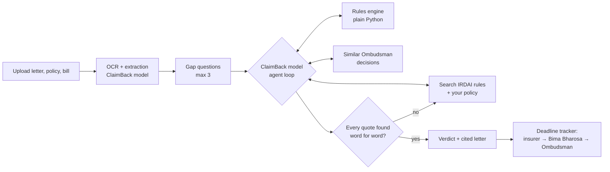

# ClaimBack

[](https://github.com/mahak867/claimback/actions/workflows/tests.yml)

An AI agent that fights rejected Indian health insurance claims. Upload the rejection letter; ClaimBack checks it against IRDAI rules and your own policy, shows how the Insurance Ombudsman ruled in cases like yours, and writes a cited appeal in English, Tamil or Hindi. Free for patients.

Built for AI Vibeathon 2026 (DotRepo, powered by Adaption), **Open Innovation** track, by Mahak Fahad and Roshini R.


25-second walkthrough of the prototype: [docs/demo.mp4](docs/demo.mp4).

## Why

- Indian insurers disallowed or rejected about ₹26,038 crore of health claims in FY24, and about 1 in 12 health claims in FY25.
- In an open analysis of 3,831 published Ombudsman rulings on rejected claims, 47% of policyholders got money back (fully, partly or ex gratia).
- Yet most families never appeal: rejection letters cite clauses in legal English, policies run to 40+ pages, and paid recovery firms charge 15–18% of the claim.

## How it works



- **Rules in code, not in the model.** Legal limits live in [`claimback/rules.py`](claimback/rules.py), each tied to its source document and unit-tested.
- **Verified citations.** A letter cannot be downloaded while any citation is unverified.
- **Our own open model.** An open-weight model fine-tuned on Adaption with IRDAI regulations and Ombudsman decisions, exportable and self-hostable, so patient documents need not leave our servers.

## What is in this repo

| Path | What it is | Status |
| --- | --- | --- |
| [`prototype/`](prototype/index.html) | Clickable prototype of all six screens on a fictional case, in English, Tamil and Hindi | Done |
| [`claimback/rules.py`](claimback/rules.py) | Rules engine: moratorium, pre-existing-disease wait cap, insurer's own health check, cashless delay; case strength | Done, tested |
| [`claimback/citations.py`](claimback/citations.py) | Citation verifier: a quote is shown only if found word for word in its source (OCR-tolerant) | Done, tested |
| [`claimback/letter.py`](claimback/letter.py) | Grievance letter in the patient's voice; refuses to build while any citation is unverified | Done, tested |
| [`claimback/deadlines.py`](claimback/deadlines.py) | Escalation ladder (insurer → Bima Bharosa → Ombudsman) and a calendar (.ics) export | Done, tested |
| [`claimback/demo.py`](claimback/demo.py) | End-to-end run on the sample case: rules → verified citations → letter → deadlines | Done |
| [`claimback/taxonomy.py`](claimback/taxonomy.py) | Rejection-ground labels (adapted from Alei) | Done |
| [`tools/validate_dataset.py`](tools/validate_dataset.py) | Screens Adaption-generated training data: JSON validity, verbatim quotes, dates, amounts, label balance | Done |
| Model fine-tuning on Adaption | 1,000-example extraction dataset generated; Ombudsman-decision dataset next | In progress |
| Agent loop, retrieval, letter generator, web app | Built during the 24-hour round | Planned |

Run the tests (24 Python tests, plus browser tests and a WCAG 2.2 AA accessibility audit of every prototype screen in light and dark mode, on laptop and phone; all run on every push by GitHub Actions) and the end-to-end demo:

```bash
pip install pytest && python -m pytest -q
python -m claimback.demo
```

Browser and accessibility tests:

```bash
npm i --no-save playwright@1.63.0 axe-core@4.10.2 && npx playwright install chromium
node tests/e2e/prototype.e2e.cjs
```

Check a dataset exported from Adaption:

```bash
python tools/validate_dataset.py path/to/export.jsonl
```

## Rule sources

Every limit in `rules.py` names its source and carries `confirmed: False` until a team member has read the clause in the official text:

- IRDAI Master Circular on Health Insurance Business, 29 May 2024 (IRDAI/HLT/CIR/PRO/84/5/2024)
- IRDAI (Insurance Products) Regulations 2024
- Insurance Ombudsman Rules 2017, as amended to 9 November 2023

## Credits

- Rejection-ground taxonomy adapted from [Alei](https://github.com/Ashmit-rai17/alei) (MIT), a dataset of Indian Insurance Ombudsman awards.
- Ideas borrowed with thanks from [Fight Health Insurance](https://github.com/fighthealthinsurance/fighthealthinsurance) (Apache-2.0; ranking several candidate letters), [Overturn](https://github.com/josephj357/overturn-showcase) (blocking letters with untraceable citations) and [health-insurance-case-file](https://github.com/buildtherecord/health-insurance-case-file) (deadlines first, claim-file requests, adversarial review).
- Interface reviewed with Anthropic's [frontend-design](https://github.com/anthropics/skills) skill and [unslop](https://github.com/heydamir/unslop) by Damir Sokolovsky (CC BY 4.0).

## Disclaimer

ClaimBack is a hackathon prototype and not legal advice. The case, people, insurer and decisions in the prototype are fictional.

## Licence

MIT
