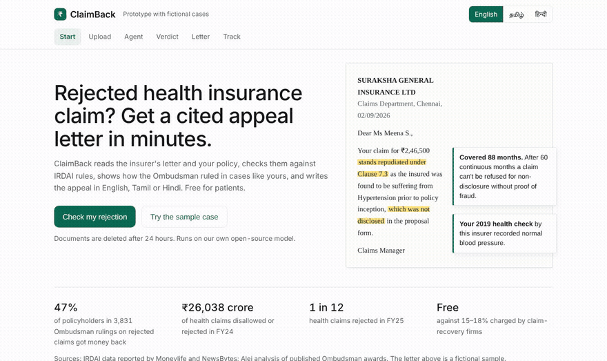
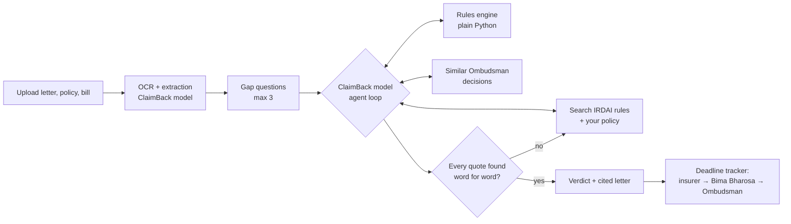

# ClaimBack

[](https://github.com/mahak867/claimback/actions/workflows/tests.yml)

An AI agent that fights rejected Indian health insurance claims. Upload the rejection letter; ClaimBack checks it against IRDAI rules and your own policy, shows how the Insurance Ombudsman ruled in cases like yours, and writes a cited appeal in English, Tamil or Hindi. Free for patients.

Built for AI Vibeathon 2026 (DotRepo, powered by Adaption), **Open Innovation** track, by Mahak Fahad and Roshini R.



**Live prototype: [claimback-eight.vercel.app](https://claimback-eight.vercel.app)** · 34-second walkthrough: [docs/demo.mp4](docs/demo.mp4).

## For judges: try it in 60 seconds

1. Open **[claimback-eight.vercel.app](https://claimback-eight.vercel.app)** and press **Check my rejection**.
2. Press **Fill in an example**, then **Check this letter**: the reason, the exact sentence and clause the insurer relied on, and every IRDAI rule that applies, each with its clause number.
3. Paste any real rejection letter, or upload the insurer's PDF. It is analysed in your browser; nothing is uploaded.
4. Press **Draft my grievance letter**.
5. Open **Verdict** and switch between the three sample cases and English, தமிழ் and हिन्दी.

## Why

- Indian insurers disallowed or rejected about ₹26,038 crore of health claims in FY24, and about 1 in 12 health claims in FY25.
- In an open analysis of 3,831 published Ombudsman rulings on rejected claims, 47% of policyholders got money back (fully, partly or ex gratia).
- Yet most families never appeal: rejection letters cite clauses in legal English, policies run to 40+ pages, and paid recovery firms charge 15–18% of the claim.

## How it works



- **Rules in code, not in the model.** Legal limits live in [`claimback/rules.py`](claimback/rules.py), each tied to its source document and unit-tested.
- **Verified citations.** A letter cannot be downloaded while any citation is unverified.
- **Our own open model.** Qwen3.5-4B (open-weight), fine-tuned with LoRA on Adaption's AutoScientist using our dataset ([training run 1](docs/training-run-1.json)). At 4B parameters it runs on a single GPU, so patient documents need not leave our servers. Evaluation plan: [docs/evaluate-model.md](docs/evaluate-model.md).

## What is in this repo

| Path | What it is | Status |
| --- | --- | --- |
| Live letter checker (prototype, "Your letter") | Paste any rejection letter: the rules engine runs in the browser, finds the reason, the exact sentence and clause, applies the confirmed IRDAI rules and drafts the grievance. Nothing is uploaded. Matches the Python engine exactly on 374 letters ([`tools/check_browser_parity.cjs`](tools/check_browser_parity.cjs)) | Done, tested |
| [`prototype/`](prototype/index.html) | Clickable prototype of all six screens with three sample cases (two strong, one honestly rated Fair) and real Ombudsman awards, in English, Tamil and Hindi | Done |
| [`claimback/rules.py`](claimback/rules.py) | Rules engine: moratorium (with sum-insured and permanent-exclusion limits), waiting-period cap, insurer collects documents, discharge and cashless delays, rejection must cite terms, insurer's own health check; case strength | Done, tested |
| [`claimback/citations.py`](claimback/citations.py) | Citation verifier: a quote is shown only if found word for word in its source (OCR-tolerant) | Done, tested |
| [`claimback/letter.py`](claimback/letter.py) | Grievance letter in the patient's voice; refuses to build while any citation is unverified | Done, tested |
| [`claimback/deadlines.py`](claimback/deadlines.py) | Escalation ladder (insurer → Bima Bharosa → Ombudsman) and a calendar (.ics) export | Done, tested |
| [`claimback/precedents.py`](claimback/precedents.py) | Precedent finder: past Ombudsman awards on the same rejection reason, ranked by similarity, outcome read from the decision text ("not stated" when absent, never guessed); tested on real redacted awards from Alei | Done, tested |
| [`claimback/extract_baseline.py`](claimback/extract_baseline.py), [`tools/eval_extraction.py`](tools/eval_extraction.py), [`tools/prepare_training.py`](tools/prepare_training.py) | Rule-based extraction baseline (69.9% mean, under 10% on clause and reason quote), field-level evaluator, and 80/20 train/test split for fine-tuning | Done, tested |
| [`claimback/demo.py`](claimback/demo.py) | End-to-end run on the sample case: rules → verified citations → letter → deadlines | Done |
| [`claimback/taxonomy.py`](claimback/taxonomy.py) | Rejection-ground labels (adapted from Alei) | Done |
| [`tools/validate_dataset.py`](tools/validate_dataset.py) | Screens Adaption-generated training data: JSON validity, verbatim quotes, dates, amounts, label balance | Done |
| Model fine-tuning on Adaption | Dataset v2 (96% usable); run 1: Qwen3.5-4B, LoRA, 2 epochs on an H100 | Training |
| Agent loop, retrieval, letter generator, web app | Built during the 24-hour round | Planned |

Run the tests (38 Python tests, plus browser tests and a WCAG 2.2 AA accessibility audit of every prototype screen in light and dark mode, on laptop and phone; all run on every push by GitHub Actions) and the end-to-end demo:

```bash
pip install pytest && python -m pytest -q
python -m claimback.demo
```

Browser and accessibility tests:

```bash
npm i --no-save playwright@1.63.0 axe-core@4.10.2 pdfjs-dist@3.11.174 && npx playwright install chromium
node tests/e2e/prototype.e2e.cjs
```

Check a dataset exported from Adaption:

```bash
python tools/validate_dataset.py path/to/export.jsonl
```

## Results so far

See [docs/results.md](docs/results.md). A keyword baseline scores 0.89 macro-F1 on our synthetic letters but only 0.54 on real Ombudsman awards (Alei), so the target for the fine-tuned model is to beat 0.70 on real awards. Dataset v1 was 37% clean; the v2 description fixing its defects is in [docs/adaption-dataset-v2.md](docs/adaption-dataset-v2.md).

## Rule sources

Every limit in [`claimback/rules.py`](claimback/rules.py) is confirmed against the official IRDAI text, with its clause recorded, and a test fails if any is not:

| Rule | Source |
| --- | --- |
| 60-month moratorium: no claim contestable for non-disclosure except established fraud; ported and migrated cover counts | Master Circular on Health Insurance Business (29 May 2024), Chapter I para 13, p.22 |
| Moratorium covers the original sum insured; increases restart it; permanent exclusions survive it | Master Circular on Protection of Policyholders' Interests 2024, customer information sheet, p.196 |
| Cashless decision within 1 hour; discharge approval within 3 hours, delay charges borne by the insurer | Health Master Circular, Chapter I paras 15(b), 16 |
| No rejection without Claims Review Committee approval; rejection must cite specific policy terms; insurer collects documents from the hospital | Health Master Circular, Chapter I para 17(a)-(c), p.23 |
| Insurer resolves a grievance within 14 days; Bima Bharosa; Ombudsman free, claims up to Rs 50 lakh | Policyholders' Interests circular, Section VI, p.110 |
| Pre-existing-disease waiting period at most 36 months | IRDAI (Insurance Products) Regulations 2024; IRDAI Health Department page |

## Credits

- Rejection-ground taxonomy adapted from [Alei](https://github.com/Ashmit-rai17/alei) (MIT), a dataset of Indian Insurance Ombudsman awards.
- Ideas borrowed with thanks from [Fight Health Insurance](https://github.com/fighthealthinsurance/fighthealthinsurance) (Apache-2.0; ranking several candidate letters), [Overturn](https://github.com/josephj357/overturn-showcase) (blocking letters with untraceable citations) and [health-insurance-case-file](https://github.com/buildtherecord/health-insurance-case-file) (deadlines first, claim-file requests, adversarial review).
- Interface reviewed with Anthropic's [frontend-design](https://github.com/anthropics/skills) skill and [unslop](https://github.com/heydamir/unslop) by Damir Sokolovsky (CC BY 4.0).

## Disclaimer

ClaimBack is a hackathon prototype and not legal advice. The case, people, insurer and decisions in the prototype are fictional.

## Licence

MIT
