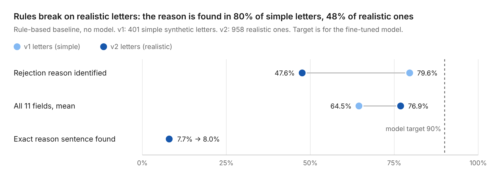

# Results so far

## Rejection-reason classification baseline

| Data | Model | Macro-F1 | Accuracy | Notes |
| --- | --- | --- | --- | --- |
| ClaimBack v1 synthetic letters (374 clean rows of 1,000, Adaption Invent) | TF-IDF + logistic regression, 5-fold CV | 0.894 | 0.912 | `python tools/train_baseline.py v1_clean.jsonl` |
| Real Indian Ombudsman awards (64 human-labelled, from [Alei](https://github.com/Ashmit-rai17/alei/blob/main/docs/RESULTS.md)) | TF-IDF + logistic regression | 0.541 | | Alei's published figure; keyword rules 0.546 |
| Real Ombudsman awards, LLM labels with verified quotes (Alei) | LLM | 0.703 | | Alei's published figure |

**What this tells us.** Synthetic letters are too easy: they name the rejection reason almost word for word, so a keyword model scores 0.89. On real awards the same kind of model drops to 0.54. A model that only ever sees clean synthetic letters will look good in testing and fail on real ones. So:

1. v2 data adds format variety, OCR noise, long bureaucratic letters and Tamil/Hindi ([adaption-dataset-v2.md](adaption-dataset-v2.md)).
2. The real test set is built from published Ombudsman awards (via the Alei pipeline), never used for training.
3. **Target for the fine-tuned ClaimBack model: beat 0.70 macro-F1 on real awards**, the best published figure, with every quote verified.

Hardest classes on v1 (lowest F1): `pre_existing_disease` 0.73, `treatment_not_covered` 0.73, `excluded_by_clause` 0.75. These are also the ones people confuse in real letters, because a pre-existing condition is often rejected through an exclusion clause.

## Field extraction baseline (no model)

Rule-based extractor ([`claimback/extract_baseline.py`](../claimback/extract_baseline.py)) on the 374 clean v1 rows, scored by [`tools/eval_extraction.py`](../tools/eval_extraction.py):

| Field | Rules | Field | Rules |
| --- | --- | --- | --- |
| claim_amount_inr | 97.9% | discharge_date | 89.6% |
| claim_type | 94.9% | admission_date | 79.7% |
| insurer_name | 94.1% | rejection_ground | 78.9% |
| policy_inception_date | 91.4%* | diagnosis | 69.3% |
| policy_number | 59.4% | clause_cited | **8.3%** |
| mean of 11 fields | **69.9%** | rejection_reason_quote | **5.6%** |

\* Mostly correct nulls: most letters don't state the start date.

**What this tells us.** Rules handle amounts, dates and claim types. They fail on the two fields that need judgement: which clause the insurer relied on, and the exact sentence giving the reason (both under 10%). Those are the fields the fine-tuned model is for, and the ones the appeal letter depends on. **Target for the model: above 90% on both, with every quote verbatim.**

To train: `python tools/prepare_training.py split/ v1_clean.jsonl v2_clean.jsonl` writes `train.jsonl` and `test.jsonl` (80/20 by rejection reason, duplicates removed). v1 alone gives 300 train and 74 test rows.

## Dataset quality

| Version | Rows | Usable under `validate_dataset.py` | Inputs that were instructions | Quotes not verbatim | Notes |
| --- | --- | --- | --- | --- | --- |
| v1 | 1,000 | 401 (40%) | 374 | 419 | One real insurer named 50 times; Adaption diversity 0.12 |
| **v2** | 1,000 | **958 (96%)** | **0** | **25** | Fictional insurers rotated; still short (median 45 words), only 5% Tamil and 2% Hindi, reasons uneven (231 excluded-by-clause vs 16 fraud) |

v2 came from the rewritten description in [adaption-dataset-v2.md](adaption-dataset-v2.md). Combined and de-duplicated: 1,359 rows, split 1,087 train / 272 test by `tools/prepare_training.py`.

## Baselines on v2 (the numbers the model must beat)

(Drawn by `tools/make_baseline_chart.py`; colours checked with a palette validator for colour-blind safety and contrast.)

| Measure | v1 letters | v2 letters | What it shows |
| --- | --- | --- | --- |
| Rules: rejection reason | 79.6% | **47.6%** | Rules break as letters get realistic |
| Rules: exact reason sentence | 7.7% | **8.0%** | Rules can't pick the sentence the appeal quotes |
| Rules: mean of 11 fields | 64.5% | 76.9% | Amounts and dates are easy; judgement is not |
| Classifier trained on v1 | | macro-F1 0.662 on v2 | v1 alone doesn't generalise |
| Classifier trained on v2 | macro-F1 0.805 on v1 | | v2 is the better training set |
| Classifier, 5-fold on v1+v2 | macro-F1 0.849 | | |

(The rule extractor now returns null for claim type unless the letter says it, matching the instruction to never invent a value; v1's labels guessed "reimbursement", so its claim-type score fell.)

**Plan to measure the fine-tuned model without leakage:** train on v2 inside Adaption, then test on the 401 usable v1 letters, which the model never sees. Targets: reason classification above the v2-trained classifier's 0.805 macro-F1 on v1, and the exact reason sentence above 90% (rules: 7.7%), with every quote verbatim.

## Software

38 Python tests (rules, citations, letter, deadlines, precedent finder, extraction baseline and evaluator, dataset checker), plus browser tests and a WCAG 2.2 AA accessibility audit of all six prototype screens in light and dark mode on laptop and phone. All run on every push.
